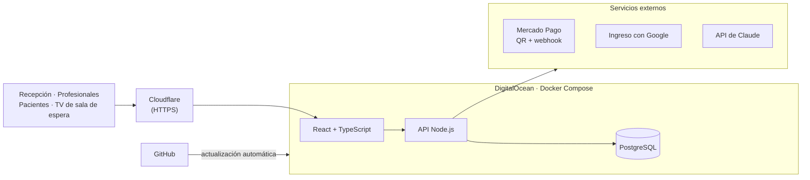

[English](https://github.com/jlvillegas) · **Español**

### 👋 Hola, soy Jorge

Técnico en IT y sistemas en Merlo, San Luis, Argentina. Mantengo funcionando negocios reales: soy **responsable de IT de una clínica odontológica desde 2015**, fui **encargado de sistemas en una empresa que trabaja con SAP**, y diseño e instalo **redes, enlaces Starlink y cámaras** para casas, cabañas y comercios.

También **desarrollé y tengo en producción** el sistema de gestión de la clínica, que usan todos los días cinco profesionales, la recepción y la administración, sobre Docker, PostgreSQL, DigitalOcean y Cloudflare.

Ahora me estoy especializando en **cloud sobre Microsoft Azure** (certificado AZ-900 y AI-901).

> 🎯 **Busco trabajo remoto como:** soporte IT / mesa de ayuda · NOC · soporte de redes · administrador cloud junior (Azure) · ingeniero de soporte técnico

### 🧰 Qué aporto

- 🖥️ **Soporte IT** — soporte diario al personal: PCs con Windows, impresoras, software, conectividad y usuarios de SAP.
- 🌐 **Redes y seguridad** — Starlink, Wi-Fi 6 mesh, TP-Link Omada, MikroTik, Ubiquiti, TCP/IP; cámaras IP (Hikvision, Dahua, EZVIZ), alarmas y control de acceso.
- ☁️ **Cloud y servidores** — servidor Linux con Docker Compose, PostgreSQL, DigitalOcean, Cloudflare, actualización automática desde GitHub y pruebas automáticas. Certificado en fundamentos de Azure.
- 🤖 **IA y automatización** — API de Claude, API de Gemini y flujos de n8n que eliminan trabajo manual.

### 🚀 Proyectos destacados

#### 🦷 Sistema de gestión de la Clínica Villegas — *en producción*

Reemplazó el software anterior, las planillas y el papel de una clínica odontológica con más de 30 años.

- Agenda por profesional y turnos online que el paciente confirma o cancela desde un link
- Historia clínica con odontograma, radiografías y presupuestos
- Cobros con QR de Mercado Pago confirmados por webhook, caja diaria y liquidaciones
- Sala de espera: la TV llama a los pacientes con voz neuronal generada en el propio servidor
- IA en el consultorio: dictado clínico y lectura de fichas en papel con la API de Claude
- Ingreso con Google y permisos por rol · **53 grupos de pruebas automáticas**

El código es privado porque es un sistema de salud. Arquitectura y una demo con datos inventados en el <a href="https://jlvillegas.github.io/portfolio/">portfolio</a>. Desarrollado con asistentes de IA (Claude y Codex).

#### Más proyectos

| Proyecto | Qué es | Estado |
|---|---|---|
| [**AI Lead Qualifier**](https://github.com/jlvillegas/ai-lead-qualifier) | Flujo de n8n: formulario → validación → Gemini califica la consulta (JSON) → Google Sheets → aviso por Gmail de las prioritarias. Ninguna consulta se pierde, aunque falle la IA. | 🟢 Código abierto + video demo |
| **Wi-Fi 6 para un complejo de diez cabañas** | Dos Starlink Mini como enlace, access points de exterior y mesh Wi-Fi 6 para todo el predio, en Nono, Córdoba. El presupuesto separó equipos, cableado, mano de obra y abono mensual. | ✅ Entregado |
| [**villegasinsumos.com**](https://villegasinsumos.com/) | Tienda online de insumos médicos y odontológicos: más de 200 productos con variantes, búsqueda y categorías. El carrito envía el pedido por WhatsApp y el sitio muestra si el local está abierto. | 🟢 En línea |
| **Sitios para negocios de Merlo** | [Clínica Villegas](https://villegascentromedicoodontologico.com/) · [Marca personal de una odontóloga](https://odontologa-alejandravillegas.netlify.app/) · [Residencia Franciscus](https://franciscus-merlo-san-luis.netlify.app/) — pensados para recibir consultas por WhatsApp desde el celular. | 🟢 En línea |
| [**Portfolio**](https://jlvillegas.github.io/portfolio/) | Hecho a mano con HTML, CSS y JavaScript, con tema claro/oscuro y un tablero que comprueba si los sitios publicados responden. | 🟢 En línea |

### 🛠️ Con qué trabajo

**Redes:** Starlink · TP-Link Omada · MikroTik · Ubiquiti · cámaras Hikvision, Dahua y EZVIZ
**Otros:** SAP ERP · DigitalOcean · n8n · API de Claude · API de Gemini

### 💼 Experiencia

| Puesto | Empresa | Fechas |
|---|---|---|
| **Fundador y técnico en redes y seguridad** | Villegas Insumos Tecnológicos (autónomo) | oct. 2023 – actualidad |
| **Responsable de IT y sistemas** | Clínica Villegas (clínica odontológica) | oct. 2015 – actualidad |
| **Encargado de sistemas** | Sonne S.R.L. — sistemas, red, servidores, cámaras y soporte a usuarios de SAP | oct. 2021 – ago. 2023 |

### 🎓 Formación y certificaciones

- ✅ **Microsoft Certified: Azure Fundamentals (AZ-900)** — oct. 2026 · [verificar](https://learn.microsoft.com/api/credentials/share/en-us/JorgeVillegas-6113/4644DE0052ADC6FE?sharingId=6314E6AE393F7D46)
- ✅ **Microsoft Certified: Azure AI Fundamentals (AI-901)** — oct. 2026 · [verificar](https://learn.microsoft.com/api/credentials/share/en-us/JorgeVillegas-6113/A836E11048C2F42E?sharingId=6314E6AE393F7D46)
- 📚 Estudiando: **AZ-104** (Azure Administrator) y **AI-103** (Azure AI Apps and Agents)
- 🎓 Licenciatura en Informática, Universidad Siglo 21 — 2024–2027 · título intermedio: Analista Universitario en Sistemas de Computación
- 🗣️ Español (nativo) · inglés (intermedio, practico todos los días)

### 📫 Contacto

Disponible para **trabajo remoto, relación de dependencia o por contrato**. Escribime por [email](mailto:lvillegasjorge@gmail.com) o [LinkedIn](https://www.linkedin.com/in/jorge-luis-villegas-oliva-212704125/).

