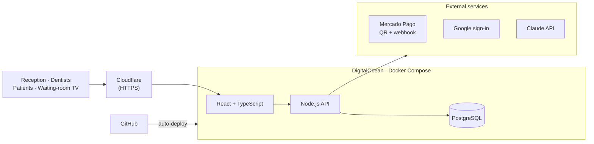

**English** · [Español](https://github.com/jlvillegas/jlvillegas/blob/main/README.es.md)

### 👋 Hi, I'm Jorge

IT and systems technician from Argentina. I keep real businesses running: I've been **Head of IT at a dental clinic since 2015**, I was **IT Systems Lead at a company running SAP**, and I design and install **networks, Starlink links and CCTV** for homes, cabins and businesses.

I also **built and run in production** the clinic's management system — used every day by 5 practitioners, reception and admin — on Docker, PostgreSQL, DigitalOcean and Cloudflare.

Now I'm growing into **cloud on Microsoft Azure** (AZ-900 and AI-901 certified).

> 🎯 **Looking for remote roles:** IT Support / Help Desk · NOC · Network Support · Junior Cloud Administrator (Azure) · Technical Support Engineer
> 🕒 UTC-3 — only 1–2 hours from US Eastern time

### 🧰 What I bring

- 🖥️ **IT Support & Help Desk** — day-to-day support for staff: Windows workstations, printers, software, connectivity and SAP users.
- 🌐 **Networking & security** — Starlink, Wi-Fi 6 mesh, TP-Link Omada, MikroTik, Ubiquiti, TCP/IP; IP cameras (Hikvision, Dahua, EZVIZ), alarms and access control.
- ☁️ **Cloud & servers** — Linux server with Docker Compose, PostgreSQL, DigitalOcean, Cloudflare, auto-deploy from GitHub, automated tests. Azure fundamentals certified.
- 🤖 **AI & automation** — Claude API, Gemini API and n8n workflows that remove manual work.

### 🚀 Featured work

#### 🦷 Clínica Villegas management system — *in production*

Replaced the legacy software, spreadsheets and paper of a dental clinic with 30+ years of history.

- Per-practitioner schedule and online appointments that patients confirm or cancel from a link
- Clinical records with odontogram, X-rays and treatment quotes
- Mercado Pago QR payments confirmed by webhook, daily cash register and practitioner payouts
- Waiting room: the TV calls patients with a neural voice generated on our own server
- AI in the office: clinical dictation and reading of paper records with the Claude API
- Google sign-in and role-based permissions · **53 automated test suites**

The code is private because it is a healthcare system. Architecture details and a demo with fake data are in the <a href="https://jlvillegas.github.io/portfolio/">portfolio</a>. Built with AI coding assistants (Claude and Codex).

#### More projects

| Project | What it is | Status |
|---|---|---|
| [**AI Lead Qualifier**](https://github.com/jlvillegas/ai-lead-qualifier) | n8n workflow: web form → data validation → Gemini qualifies the lead (JSON) → Google Sheets → Gmail alert for hot leads. Leads are never lost, even if the AI fails. | 🟢 Open source + demo video |
| **Wi-Fi 6 for a 10-cabin tourist complex** | Two Starlink Mini uplinks, outdoor access points and Wi-Fi 6 mesh covering the whole property in Nono, Córdoba. The quote split equipment, cabling, labor and monthly service. | ✅ Delivered |
| [**villegasinsumos.com**](https://villegasinsumos.com/) | Online store for medical and dental supplies: 200+ products with variants, search and categories. The cart sends the order by WhatsApp and the site shows if the store is open. | 🟢 Live |
| **Websites for local businesses** | [Clínica Villegas](https://villegascentromedicoodontologico.com/) · [Dentist personal brand](https://odontologa-alejandravillegas.netlify.app/) · [Residencia Franciscus](https://franciscus-merlo-san-luis.netlify.app/) — built to receive inquiries by WhatsApp from mobile. | 🟢 Live |
| [**Portfolio**](https://jlvillegas.github.io/portfolio/) | Hand-made with HTML, CSS and JavaScript, light/dark theme and a status board that checks the published sites. | 🟢 Live |

### 🛠️ Tech I use

### 💼 Experience

| Role | Company | Dates |
|---|---|---|
| **Founder & Network / Security Technician** | Villegas Insumos Tecnológicos (self-employed) | Oct 2023 – present |
| **Head of IT & Systems** | Clínica Villegas (dental clinic) | Oct 2015 – present |
| **IT Systems Lead** | Sonne S.R.L. — IT systems, network, servers, CCTV and SAP user support | Oct 2021 – Aug 2023 |

Full details on <a href="https://www.linkedin.com/in/jorge-luis-villegas-oliva-212704125/">LinkedIn</a>.

### 🎓 Certifications & education

- ✅ **Microsoft Certified: Azure Fundamentals (AZ-900)** — Oct 2026 · [verify](https://learn.microsoft.com/api/credentials/share/en-us/JorgeVillegas-6113/4644DE0052ADC6FE?sharingId=6314E6AE393F7D46)
- ✅ **Microsoft Certified: Azure AI Fundamentals (AI-901)** — Oct 2026 · [verify](https://learn.microsoft.com/api/credentials/share/en-us/JorgeVillegas-6113/A836E11048C2F42E?sharingId=6314E6AE393F7D46)
- 📚 Studying: **AZ-104** (Azure Administrator) and **AI-103** (Azure AI Apps and Agents)
- 🎓 Bachelor's in Computer Science (Licenciatura en Informática), Universidad Siglo 21 — 2024–2027 · intermediate degree: University Analyst in Computer Systems
- 🗣️ Spanish (native) · English (intermediate, practicing every day)

### 📫 Let's talk

Open to **remote full-time or contract roles**. The fastest way to reach me is [email](mailto:lvillegasjorge@gmail.com) or [LinkedIn](https://www.linkedin.com/in/jorge-luis-villegas-oliva-212704125/).

